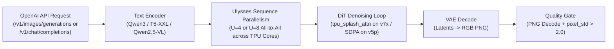

# Image Diffusion Serving on Google Cloud TPUs (TorchTPU)

PyTorch (`torch_tpu`) serving benchmarks for image diffusion models on **Google Cloud TPU v7x** and **TPU v5p**, evaluated across **`vllm-torchtpu v0.33.0` + `vllm-omni 0.33.0rc1`** and **`sglang-torchtpu` (`main`)**. On 4-chip TPU v7x, **FLUX.2-klein-4B** reaches **`0.419 s`** (`139.3 img/min` at `c=2`, `1.36×` lower latency than the published `~0.57 s` single-GPU H200 reference) and **`373.8 img/min`** (`DP=8`), scaling to **`730.43 img/min`** on **8 TPU v7x chips (`DP=16`, `97.7%` linear scaling)**. **Z-Image-Turbo** reaches **`270.4 img/min`** (`4` chips) and **`589.01 img/min`** (`8` chips, `1024²`) / **`109.94 img/min`** (`2048²`), while 20B **Qwen-Image** scales across **16 TPU v7x chips (`external DP=4`, `CFG=2×U=2 + Cache-DiT`)** to **`63.32 img/min`** (`3.71 s` median).

---

## Models & Licenses

This repository tracks image diffusion model serving benchmarks on Google Cloud TPUs. Each model's folder contains detailed tables and reproduction commands.

| Model | Params & Precision | Default Steps | Architecture Summary | License | Folder |
| :--- | :---: | :---: | :--- | :---: | :--- |
| [`black-forest-labs/FLUX.2-klein-4B`](https://huggingface.co/black-forest-labs/FLUX.2-klein-4B) | 4B (`bf16`) | 4 | Step-distilled rectified-flow DiT + Qwen3-4B text encoder | Apache-2.0 | [`flux2-klein-4b/`](flux2-klein-4b/README.md) |
| [`black-forest-labs/FLUX.1-schnell`](https://huggingface.co/black-forest-labs/FLUX.1-schnell) | 12B (`bf16`) | 4 | Step-distilled MMDiT + T5-XXL & CLIP-L text encoders | Apache-2.0 | [`flux1-schnell/`](flux1-schnell/README.md) |
| [`Tongyi-MAI/Z-Image-Turbo`](https://huggingface.co/Tongyi-MAI/Z-Image-Turbo) | 6B (`bf16`) | 8 | Single-stream DiT (30 attention heads) + Qwen3-4B encoder | Apache-2.0 | [`z-image-turbo/`](z-image-turbo/README.md) |
| [`Qwen/Qwen-Image`](https://huggingface.co/Qwen/Qwen-Image) | 20B (`bf16`) | 20 | High-capacity MMDiT + Qwen2.5-VL-7B text encoder | Apache-2.0 | [`qwen-image-20b/`](qwen-image-20b/README.md) |

---

## Hardware & Software Stack

| Component | Configuration |
| :--- | :--- |
| **TPU v7x** | 4 chips / 8 TensorCores per host (`2×2×1`, 96 GB HBM/core); scaled to **8 chips (`2` hosts, `DP=16`)** and **16 chips (`4` hosts, `external DP=4`)** |
| **TPU v5p** | 4 chips (`2×2×1` single-host topology, 95 GB HBM per chip) |
| **Engine 1: vLLM-Omni** | `vllm-torchtpu v0.33.0` + `vllm-omni 0.33.0rc1` (`OmniTpuPlatform`, `diffusers 0.43.0`) |
| **Engine 2: SGLang** | `sgl-project/sglang-torchtpu` (`main`, `tpu_splash_attn` on v7x, PyTorch SDPA on v5p) |
| **Runtime** | PyTorch `2.13.0` + `torch_tpu 0.2.0` + `libtpu 0.0.50` |

---

## Serving Architecture & Parallelism



---

## Main Results (Verified `valid_image=True`)

Every result below was decoded from returned PNG bytes and verified to have non-trivial RGB pixel variance (`pixel_std > 2.0`).

### 1024×1024 Headline Comparison (Best Verified Configuration per Model & Engine)

| Model (Steps) | Engine | TPU v7x (4 chips) | TPU v5p (4 chips) | Comparison vs. Baseline / Reference |
| :--- | :--- | :---: | :---: | :--- |
| **FLUX.2-klein-4B** (4) | `sglang-torchtpu` (no compile) | **0.419 s** (`c=1`) / **139.3 img/min** (`c=2`) | 0.550 s (`c=1`) / 122.4 img/min (`c=2`) | **1.36×** lower latency on v7x vs. published single-GPU H200 (`~0.57 s`, [inferencebench.io](https://inferencebench.io)); **1.31×** faster on v7x vs. v5p |
| **FLUX.2-klein-4B** (4) | `vllm-torchtpu v0.33` + `omni` | **0.450 s** (`120.7 img/min`, `c=1`) | **0.431 s** (`127.0 img/min`, `c=1`) | **1.27×–1.32×** lower latency vs. published single-GPU H200 (`~0.57 s`, [inferencebench.io](https://inferencebench.io)); both valid through `2048×2048` |
| **FLUX.1-schnell** (4) | `sglang-torchtpu` (`tpu_splash_attn`) | **0.830 s** (`c=1`) / **77.5 img/min** (`c=2`) | 1.346 s (`c=1`) / 59.4 img/min (`c=4`) | **1.82×** lower latency on v7x vs. `vllm-omni` (`1.510 s`); **1.62×** faster on v7x vs. v5p |
| **FLUX.1-schnell** (4) | `vllm-torchtpu v0.33` + `omni` | 1.510 s (`c=1`) / 41.8 img/min (`c=2`) | 2.679 s (`c=1`) / 23.1 img/min (`c=2`) | **1.77×** lower latency on v7x vs. v5p |
| **Z-Image-Turbo** (8) | `sglang-torchtpu` (`--enable-torch-compile`) | **0.507 s** min / **115.9 img/min** (`c=4`) | 0.870 s min / 68.2 img/min (`c=4`) | **3.74×** higher throughput vs. `vllm-omni` (`U=2`); **2.60×** vs. eager SGLang; **1.70×** v7x vs. v5p |
| **Z-Image-Turbo** (8) | `vllm-torchtpu v0.33` + `omni` (`U=2`) | 1.902 s (`c=1`) / 31.0 img/min | *Requires `U=2` (30 heads)* | Verified valid (`pixel_std = 85.4`) after switching `U=4 -> U=2` |
| **Qwen-Image 20B** (20) | `vllm-torchtpu v0.33` + `omni` (`CFG=2×U=2 + Cache-DiT`) | **3.345 s** (`c=1`) / **19.48 img/min** (`c=2`) | *See Appendix* | **1.47×** lower latency and **1.58×** higher throughput vs. exact `U=4` (`4.921 s` / `12.36 img/min`), and **139×** vs. variable prompts |

### Multi-Replica & Multi-Host Data-Parallel Scaling (4 to 16 TPU v7x Chips, Verified `valid_image=True`)

Scaling across cores on a single host (`DP=8` on 4-chip v7x / `DP=4` on 4-chip v5p) and horizontally across multiple TPU v7x hosts behind a stateless external HTTP router (`8` chips / `DP=16` on `sglang`; `16` chips / `external DP=4` on `vllm-omni`):

| Model (Steps) | Engine & Config | Resolution | **Throughput** | Latency (Med / p95) | Scaling & Hardware Comparison |
| :--- | :--- | :---: | :---: | :---: | :--- |
| **FLUX.2-klein-4B** (4) | `sglang` (`8x v7x`, 2 hosts, **`DP=16`**) | `1024×1024` | **730.43 img/min** (`91.3/chip`, `c=64`) | `4.59 s` / `5.92 s` | **1.95×** (`97.7%` linear) vs. 4-chip v7x `DP=8` (`373.8 img/min`) |
| **FLUX.2-klein-4B** (4) | `sglang` (`4x v7x`, 1 host, `DP=8`) | `1024×1024` | **373.8 img/min** (`93.5/chip`, `c=16`) | `2.35 s` / `2.44 s` | **2.68×** vs. `U=8` (`139.3 img/min`); **1.61×** vs. 4-chip v5p `DP=4` (`231.9 img/min`) |
| **Z-Image-Turbo** (8) | `sglang` (`8x v7x`, 2 hosts, **`DP=16`**) | `1024×1024` | **589.01 img/min** (`73.6/chip`, `c=32`) | `3.20 s` / `4.84 s` | **2.18×** (`108.9%`) vs. 4-chip v7x `DP=8` (`270.4 img/min`) |
| **Z-Image-Turbo** (8) | `sglang` (`8x v7x`, 2 hosts, **`DP=16`**) | `2048×2048` | **109.94 img/min** (`13.7/chip`, `c=16`) | `8.28 s` / `9.11 s` | **1.91×** (`95.6%` linear) vs. 4-chip v7x `DP=8` (`57.5 img/min`) |
| **FLUX.1-schnell** (4) | `sglang` (`4x v7x`, 1 host, `DP=8`) | `1024×1024` | **192.3 img/min** (`48.1/chip`, `c=32`) | `9.41 s` med | **2.48×** vs. `U=8` (`77.5 img/min`) |
| **Qwen-Image 20B** (20) | `vllm-omni` (`16x v7x`, 4 hosts, **ext `DP=4`**) | `1024×1024` | **63.32 img/min** (`15.8/host`, `c=4`) | `3.71 s` / `3.94 s` | **3.57×** vs. 4-chip `c=1` (`17.75 img/min`); sustains `61.88 img/min` at `c=16` |
| **FLUX.2-klein-4B** (4) | `vllm-omni` (`16x v7x`, 4 hosts, **ext `DP=4`**) | `1024×1024` | **310.07 img/min** (`77.5/host`, `c=4`) | `0.71 s` / `0.79 s` | **6.09×** vs. built-in `vllm-omni --data-parallel-size 4` (`50.9 img/min`; see Appendix for `c>4` queueing) |

### High-Resolution Scaling (`1536×1536` and `2048×2048`, Verified `valid_image=True`)

| Model (Steps) | Engine | Resolution | TPU v7x (4 chips) | TPU v5p (4 chips) | v7x vs. v5p Speedup |
| :--- | :--- | :---: | :---: | :---: | :---: |
| **FLUX.2-klein-4B** (4) | `sglang-torchtpu` (no compile) | `1536×1536` | **0.720 s** (`79.3 img/min`) | 0.924 s (`61.5 img/min`) | **1.28×** (`1.19×` faster than vLLM-Omni on v7x) |
| **FLUX.2-klein-4B** (4) | `sglang-torchtpu` (no compile) | `2048×2048` | **1.207 s** (`43.2 img/min`) | *Blank on v5p (use vLLM-Omni)* | **1.23×** faster than vLLM-Omni on v7x |
| **FLUX.2-klein-4B** (4) | `vllm-torchtpu v0.33` + `omni` | `1536×1536` | 0.859 s (`64.5 img/min`) | 0.959 s (`57.4 img/min`) | **1.12×** |
| **FLUX.2-klein-4B** (4) | `vllm-torchtpu v0.33` + `omni` | `2048×2048` | 1.485 s (`36.9 img/min`) | **1.826 s** (`30.4 img/min`) | **1.23×** |
| **FLUX.1-schnell** (4) | `sglang-torchtpu` (`tpu_splash_attn`) | `2048×2048` | **2.008 s** (`29.5 img/min`, `c=2`) | 2.877 s (`20.7 img/min`, `c=2`) | **1.43×** |
| **FLUX.1-schnell** (4) | `vllm-torchtpu v0.33` + `omni` | `2048×2048` | 9.445 s (`6.5 img/min`, `c=2`) | 21.887 s (`2.7 img/min`, `c=1`) | **2.32×** |
| **Z-Image-Turbo** (8) | `sglang-torchtpu` (`--enable-torch-compile`) | `2048×2048` | **2.390 s** (warm steady) | 28.65 s (med, incl. recompile) | — |
| **Z-Image-Turbo** (8) | `vllm-torchtpu v0.33` + `omni` (`U=2`) | `2048×2048` | **8.833 s** (`6.7 img/min`) | *Requires `U=2`* | `3.70×` slower than warm SGLang on v7x |

*Note on the external H200 reference: the published `~0.57 s` H200 figure reflects a single-GPU deployment, while TPU latency numbers reflect 4-chip Ulysses Sequence Parallelism (`U=4` or `U=8`) on warm graphs, and `DP=8`/`DP=4` rows show full 4-chip host aggregate throughput.*

---

## Key Engineering Takeaways

1. **Choose parallelism for latency (`U=8`) vs. host throughput (`DP=8`):** On 4-chip TPU v7x, `sglang-torchtpu` `U=8` minimizes single-request latency (`0.419 s` on `FLUX.2-klein-4B`, `0.830 s` on `FLUX.1-schnell`), while `--dp-size 8 --ulysses-degree 1` lifts 4-chip host throughput by **`2.33×–2.68×`** (`373.8 img/min` on `FLUX.2-klein-4B`, `270.4 img/min` on `Z-Image-Turbo`, `192.3 img/min` on `FLUX.1-schnell`).
2. **Combine `CFG-Parallel` + `Cache-DiT` + fixed prompt bucketing on `Qwen-Image (20B)`:** On `vllm-omni 0.33.0rc1`, switching from `U=4` exact (`4.921 s` / `12.36 img/min`) to `--cfg-parallel-size 2 --ulysses-degree 2 --cache-backend cache_dit` lowers `c=1` latency to **`3.345 s`** and raises peak throughput to **`19.48 img/min`** (`valid_image = True`, `pixel_std = 40.0–60.1`).
3. **Always validate output pixels, not just HTTP 200:** Passing `--enable-torch-compile` to `sglang-torchtpu` on `FLUX.2-klein-4B` returned `200 OK` PNGs at `182–235 img/min` that were completely black (`pixel_std = 0.0`). Running without `--enable-torch-compile` restored valid high-variance images (`pixel_std = 59.6–73.6`) at `139.3 img/min` (`U=8`) and `373.8 img/min` (`DP=8`).

---

## How to Reproduce

Run any model server and point [`scripts/benchmark_image_diffusion.py`](scripts/benchmark_image_diffusion.py) at its OpenAI-compatible endpoint:

```bash
# Example 1: FLUX.2-klein-4B on SGLang (4x TPU v7x / 8 cores, no --enable-torch-compile)
sglang serve \
  --model-path /path/to/black-forest-labs/FLUX.2-klein-4B \
  --host 0.0.0.0 --port 8000 \
  --num-gpus 8 --ulysses-degree 8 \
  --attention-backend tpu_splash_attn

python3 scripts/benchmark_image_diffusion.py \
  --engine sglang --model black-forest-labs/FLUX.2-klein-4B \
  --width 1024 --height 1024 --steps 4 --concurrency 2 --num-requests 8

# Example 2: FLUX.2-klein-4B 2048x2048 on vLLM-Omni (4x TPU v7x or v5p)
vllm serve /path/to/black-forest-labs/FLUX.2-klein-4B \
  --omni --served-model-name black-forest-labs/FLUX.2-klein-4B \
  --host 0.0.0.0 --port 8000 --ulysses-degree 4

python3 scripts/benchmark_image_diffusion.py \
  --engine vllm-omni --model black-forest-labs/FLUX.2-klein-4B \
  --width 2048 --height 2048 --steps 4 --concurrency 1 --num-requests 6
```

---

## Deep Dives, Logs & Raw Results

- **Model Guides:** [`flux2-klein-4b/`](flux2-klein-4b/README.md) · [`flux1-schnell/`](flux1-schnell/README.md) · [`z-image-turbo/`](z-image-turbo/README.md) · [`qwen-image-20b/`](qwen-image-20b/README.md)
- **Ablations, Quality Audits & Failures:** [`APPENDIX.md`](APPENDIX.md)
- **Engineering Log:** [`WORKING_LOG.md`](WORKING_LOG.md)
- **Verified JSON Metrics:** [`results/image_diffusion_summary.json`](results/image_diffusion_summary.json) · [`results/v7x_multihost_image_scaling.json`](results/v7x_multihost_image_scaling.json)
